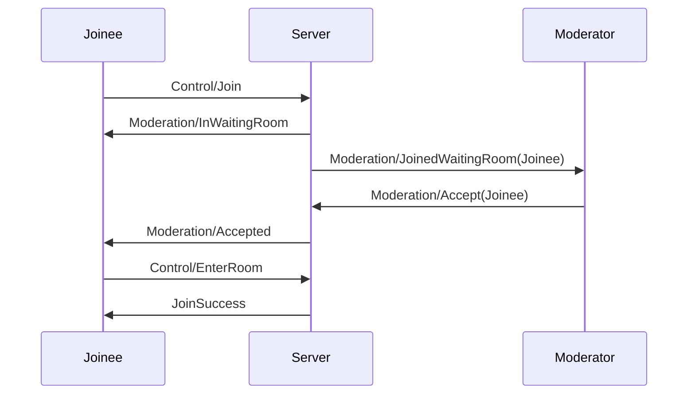

# Moderation

Module which contains logic to handle moderation based features.

Flow for joining a room with the waiting-room enabled:



## Commands

### Kick

Requires moderator role.

Remove a participant from the room.

__Fields:__

| Field    | Type     | Required | Description                   |
| -------- | -------- | -------- | ----------------------------- |
| `action` | `enum`   | yes      | Must be "kick"                |
| `target` | `string` | yes      | Id of the participant to kick |

__Example:__

```json
{
    "action": "kick",
    "target": "00000000-0000-0000-0000-000000000000"
}
```

### Ban

Requires moderator role.

Ban a user from the room. Can only be used on participants where `participation_kind` is "user". The user's user-id will
be banned from the room for the remainder of the session.

__Fields:__

| Field    | Type     | Required | Description                  |
| -------- | -------- | -------- | ---------------------------- |
| `action` | `enum`   | yes      | Must be "ban"                |
| `target` | `string` | yes      | Id of the participant to ban |

__Example:__

```json
{
    "action": "ban",
    "target": "00000000-0000-0000-0000-000000000000"
}
```

### EnableWaitingRoom

Requires moderator role.

Enable the waiting room.

__Fields:__

| Field    | Type   | Required | Description                   |
| -------- | ------ | -------- | ----------------------------- |
| `action` | `enum` | yes      | Must be "enable_waiting_room" |

__Example:__

```json
{
    "action": "enable_waiting_room"
}

```

### DisableWaitingRoom

Requires moderator role.

Disable the waiting room.

__NOTE:__ Participants inside the waiting room will not be automatically accepted.

__Fields:__

| Field    | Type   | Required | Description                    |
| -------- | ------ | -------- | ------------------------------ |
| `action` | `enum` | yes      | Must be "disable_waiting_room" |

__Example:__

```json
{
    "action": "disable_waiting_room"
}

```

### Accept

Requires moderator role.

Accept a participant inside the waiting into the room.

__Fields:__

| Field    | Type     | Required | Description                     |
| -------- | -------- | -------- | ------------------------------- |
| `action` | `enum`   | yes      | Must be "accept"                |
| `target` | `string` | yes      | Id of the participant to accept |

__Example:__

```json
{
    "action": "accept",
    "target": "00000000-0000-0000-0000-000000000000"
}

```

## Events

### Kicked

Received when you were kicked from the room. Will be the last message before server-side websocket disconnection.

| Field     | Type   | Always | Description |
| --------- | ------ | ------ | ----------- |
| `message` | `enum` | yes    | Is "kicked" |

__Example:__

```json
{
    "message": "kicked"
}
```

### Banned

Received when you were banned from the room. Will be the last message before server-side websocket disconnection.

| Field     | Type   | Always | Description |
| --------- | ------ | ------ | ----------- |
| `message` | `enum` | yes    | Is "banned" |

__Example:__

```json
{
    "message": "banned"
}
```

### In Waiting Room

Received after sending [Join](#join) in a room which has the waiting-room enabled. Once in the waiting room one must wait
until the [Accepted](#accepted) event was received. Then the room can be entered using [Control/EnterRoom](/api/modules/control#enterroom).

__Fields:__

| Field     | Type   | Always | Description          |
| --------- | ------ | ------ | -------------------- |
| `message` | `enum` | yes    | Is "in_waiting_room" |

```json
{
    "message": "in_waiting_room",
}
```

### JoinedWaitingRoom

Received when a participant joined the waiting-room. Wraps a [Participant](#participant). Will only contain the data
of the `control` as other modules will not be initialized before the user joins the room.

__Fields:__

| Field     | Type   | Always | Description              |
| --------- | ------ | ------ | ------------------------ |
| `message` | `enum` | yes    | Is "joined_waiting_room" |

```json
{
    "message": "joined_waiting_room",
    "id": "00000000-0000-0000-0000-000000000000",
    "control": {
        ...
    }
}
```

### LeftWaitingRoom

Received when a participant left the waiting-room. Will also be received when a participant makes the transition from
waiting-room to "conference-"room.

__Fields:__

| Field     | Type     | Always | Description            |
| --------- | -------- | ------ | ---------------------- |
| `message` | `enum`   | yes    | Is "left_waiting_room" |
| `target`  | `string` | yes    | Id of the participant  |

```json
{
    "message": "joined_waiting_room",
    "id": "00000000-0000-0000-0000-000000000000"
}
```

### WaitingRoomEnabled

Received when a moderator enabled the waiting-room.

__Fields:__

| Field     | Type   | Always | Description               |
| --------- | ------ | ------ | ------------------------- |
| `message` | `enum` | yes    | Is "waiting_room_enabled" |

```json
{
    "message": "waiting_room_enabled"
}
```

### WaitingRoomDisabled

Received when a moderator disabled the waiting-room.

__Fields:__

| Field     | Type   | Always | Description                |
| --------- | ------ | ------ | -------------------------- |
| `message` | `enum` | yes    | Is "waiting_room_disabled" |

```json
{
    "message": "waiting_room_disabled"
}
```

### Accepted

Can only be received while in the waiting room. A moderator accepted this you into the room, which can now entered using
[Control/EnterRoom](/api/modules/control#enterroom).

__Fields:__

| Field     | Type   | Always | Description   |
| --------- | ------ | ------ | ------------- |
| `message` | `enum` | yes    | Is "accepted" |

```json
{
    "message": "accepted",

}
```

### Error

__Fields:__

| Field     | Type   | Always | Description                       |
| --------- | ------ | ------ | --------------------------------- |
| `message` | `enum` | yes    | Is "error"                        |
| `error`   | `enum` | yes    | currently only `cannot_ban_guest` |

```json
{
    "message": "error",
    "error": "cannot_ban_guest"
}
```
